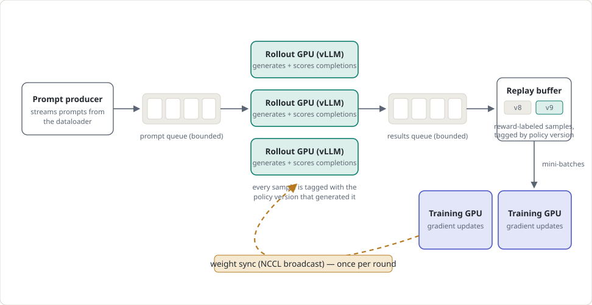
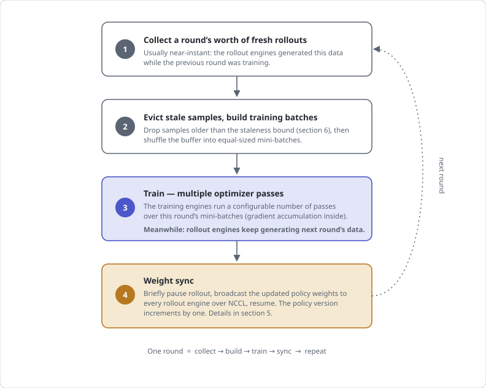
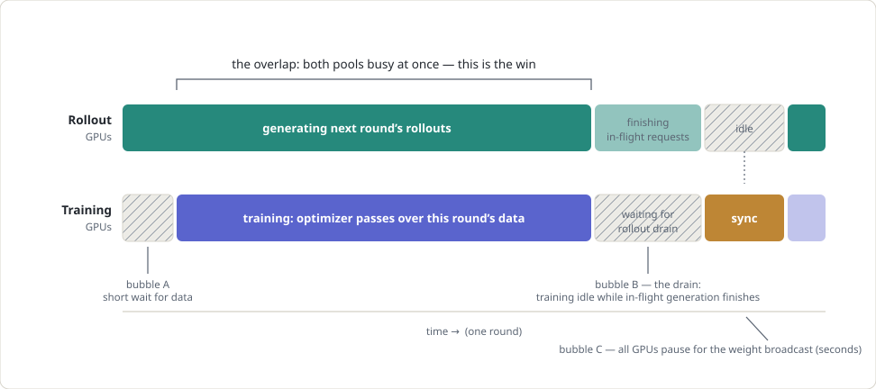
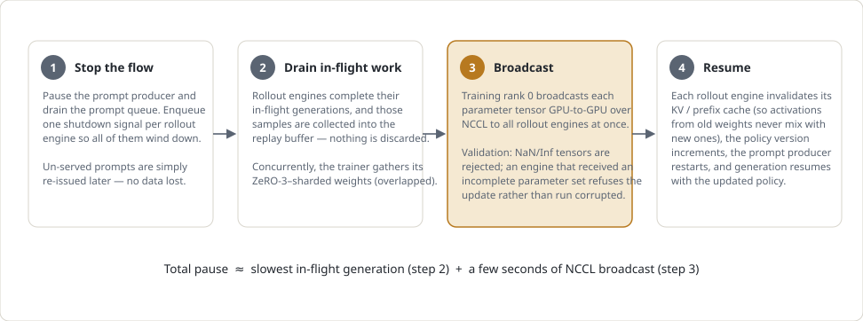
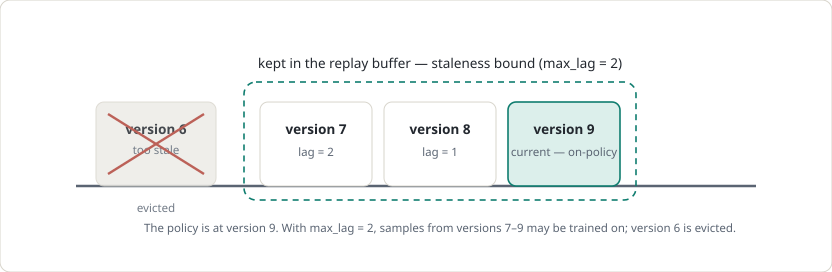

# How the FeynRL Async Engine Works

This guide explains FeynRL's overlapped RL engine: where each component runs, how rollout data and policy weights move through the system, and where the runtime goes. It uses standard ML terminology and requires no code.

## 1. The big idea: overlap generation and training

RL fine-tuning of a language model alternates between two workloads:

- **Rollout (generation)**: the current policy generates completions for a batch of prompts, and a reward function scores each completion.
- **Training**: the policy is updated with gradient steps computed on those reward-labeled rollouts.

The two workloads use different software stacks. Generation is fastest on an inference engine (vLLM) that keeps only the model weights and a KV cache in memory while batching many requests together. Training requires the full optimizer state, gradients, and activations, which can take several times the model's size in memory, and runs under a distributed training framework (DeepSpeed). Neither stack is well suited to the other's job, so FeynRL assigns separate GPUs to generation and training.

A fully synchronous engine alternates between the two: generate a batch, stop, train on it, stop, then generate again. During each phase, half the hardware is idle. The rollout GPUs wait during training, and the training GPUs wait during generation.

The async engine instead splits the GPUs into two dedicated pools that run concurrently. While the training GPUs run optimizer steps on the previous batch of rollouts, the rollout GPUs generate the next one. Once per cycle, the training side synchronizes its updated policy weights to the rollout side, and the loop continues.

This overlap means that training uses data generated by a slightly older policy. The data is *one step behind*. Section 6 explains why a bounded amount of staleness is safe and how the engine limits it and corrects for it in the loss.

## 2. The components and how data flows

Six pieces make up the pipeline. Prompts and rollout data flow from left to right, while updated policy weights flow from right to left.

<picture>
  <source media="(prefers-color-scheme: dark)" srcset="images/async_engine/fig1_pipeline_dark.svg">
  
</picture>

**Figure 1.** The pipeline. Green boxes are rollout/generation, indigo boxes are training, the amber band is the weight sync, and gray boxes are queues and storage. Both queues are bounded. When a queue fills, the producer side blocks (backpressure), so nothing overflows or is lost.

- **Prompt producer:** a lightweight background thread continuously streams prompt batches from the dataloader into the prompt queue. When it reaches the end of the dataset, it reshuffles and starts a new pass, so the queue does not run dry at epoch boundaries. Each batch is split into *shards*, with one slice per rollout engine, so all engines receive an equal share of work. When the queue is full, the producer blocks until space becomes available.
- **Rollout engines:** each engine is a vLLM inference server that owns one GPU, or a group of GPUs if the model needs tensor parallelism. An engine continuously pulls a shard of prompts and samples *several completions per prompt*. Group-based advantage estimators such as GRPO use this group of completions to compute a baseline. vLLM's *continuous batching* keeps the GPU saturated by allowing new requests to join the running batch as old ones finish instead of waiting for the entire batch to drain. For every generated token, the engine records the **behavior log-probability**, which is the probability assigned to that token by the generating policy. The training loss uses it later for off-policy correction. The engine then runs the reward function on each completion and pushes the scored samples to the results queue. Each engine is pipelined: one shard remains in flight while the previous shard is post-processed, so the GPU does not drain between shards.
- **Replay buffer:** the pool of reward-labeled samples awaiting training. Each entry holds the token sequence, its per-token rewards and advantages, the behavior log-probs, and a **policy-version tag** that identifies the policy that generated it. Section 6 explains why this tag matters. The buffer has a hard capacity derived from the config, so memory cannot grow without bound.
- **Training engines:** GPUs that hold the full training state, including optimizer moments, gradients, and model weights sharded across all training GPUs with DeepSpeed ZeRO-3. Each GPU permanently stores only a slice of every weight tensor, and slices are gathered on the fly during forward and backward passes. Every training GPU must receive the same number of mini-batches per step because all training GPUs participate in every collective operation. An uneven split would deadlock the collectives, so batch construction is kept uniform.
- **Orchestrator:** a single driver process that moves results from the queue into the buffer, dispatches training steps, tracks policy versions, monitors component health, coordinates weight synchronization, and writes checkpoints and metrics.

The two bounded queues provide flow control. If training falls behind, the results queue fills, rollout engines block on their next push, and generation pauses without separate throttling logic. If generation falls behind, the trainer waits at the start of the next round. Either side can be the bottleneck without breaking the pipeline.

## 3. The training loop: one round, four phases

The engine runs in repeating *rounds*. Each round has four phases. Phase 3 runs while the rollout engines continue generating in the background.

<picture>
  <source media="(prefers-color-scheme: dark)" srcset="images/async_engine/fig2_round_dark.svg">
  
</picture>

**Figure 2.** One round of the engine. Phases 1 and 2 are short bookkeeping phases, phase 3 contains most of the compute, and phase 4 is the only point where the two GPU pools must coordinate.

### Phase 1: collect

"A round's worth" means one full pass over the rollout dataset: a fixed number of prompt shards that the orchestrator counts as they arrive. In steady state, most of this data was already generated during the previous round's training phase. Some may also have been collected during the previous weight sync and is credited against the current round's target so it is not waited for twice. The wait has a timeout. If the target count does not arrive in time, the engine fails with a diagnosis such as slow rollout or a stuck engine instead of hanging silently.

### Phase 2: evict and batch

First, samples whose policy-version tag falls outside the staleness bound are evicted (section 6). The remaining buffer is shuffled with a seeded RNG and cut into equal-sized mini-batches that are distributed evenly across the training GPUs. Equal sizing is required under ZeRO-3 because all training GPUs participate in every collective operation. An uneven split would leave one GPU waiting indefinitely.

### Phase 3: train

The training engines run a configurable number of passes over the round's mini-batches, with gradient accumulation inside each pass. Multiple passes extract more training signal from each batch of expensive rollouts. This is safe because the loss is a *clipped* surrogate objective (PPO-family), so clipping limits how far the policy can move from the data within a round. During training, the rollout engines continue pulling prompts and generating in the background. Their output accumulates in the bounded results queue and replay buffer for the next round. The orchestrator also polls the health of every component during this phase, so a crashed engine is reported within seconds instead of only at the end of the round.

### Phase 4: sync

The policy version increments, and the updated weights are delivered to every rollout engine. Section 5 describes this process. The final round skips the sync because there is no next round to generate. Instead, it drains and collects the remaining in-flight rollouts so the run's statistics are complete.

## 4. Where the time goes

The two GPU pools overlap during the long training phase: the rollout engines generate the next round's data while the training engines update the policy. The timeline below shows one round for each pool, including the intervals where GPUs are idle, called *bubbles*.

<picture>
  <source media="(prefers-color-scheme: dark)" srcset="images/async_engine/fig3_timeline_dark.svg">
  
</picture>

**Figure 3.** One round on the clock (hatched blocks are idle time). The long middle interval is fully overlapped. Three bubbles remain: a usually short wait for data at round start (A), the drain while in-flight generations finish before the sync (B), and the weight-broadcast pause (C).

- **Bubble A, waiting for data:** at round start, the trainer needs a full round of fresh rollouts. In steady state, this data was already generated during the previous round, so the wait is short. It grows when generation throughput is lower than training throughput, which is a rollout-bound configuration.
- **Bubble B, the drain:** before the weights can be updated, every rollout engine must finish its in-flight generations because a partially generated sequence cannot switch policy versions midway (see the guarantee in section 5). The drain lasts about as long as the slowest in-flight request, so long completions with high `max_tokens` produce a longer drain. Samples generated during the drain are kept in the replay buffer and count toward the next round.
- **Bubble C, the weight broadcast:** the parameters are gathered and broadcast. This usually takes seconds and scales with model size rather than generation length.

### Which bubble dominates?

It depends on the workload. With long completions, such as reasoning-style generation with thousands of tokens per response, bubble B dominates because the slowest in-flight request can take minutes to finish. With short completions and a large model, bubble C's broadcast becomes the visible cost. Bubble A appears when the GPU split is out of balance. If the rollout pool cannot produce a round's worth of data in the time the training pool takes to consume one, the trainer starves. The engine logs a *speed ratio* each round, defined as rollout output produced per round divided by one round's demand. A ratio below 1 means more rollout capacity is needed, or less generation should be requested. A ratio above 1 means rollout capacity exceeds demand, so some output may age out unused.

## 5. Weight synchronization, step by step

Once per round, the rollout engines' copy of the policy is replaced with the newly updated policy from the training side. The training weights are sharded across all training GPUs with ZeRO-3, while the rollout copies live inside separate vLLM server processes. Synchronization moves those weights between the two without an intermediate disk write. It happens in four steps:

<picture>
  <source media="(prefers-color-scheme: dark)" srcset="images/async_engine/fig4_weight_sync_dark.svg">
  
</picture>

**Figure 4.** The weight sync. Step 2 is the expensive part. Step 3 is fast because parameters travel directly between GPUs over the cluster's high-speed interconnect and never touch disk.

Implementation details:

- Weight gathering overlaps the drain. Reassembling the full weights from their ZeRO-3 slices takes time, so the trainer starts gathering as soon as the shutdown signals are sent in step 1 and runs it concurrently with the drain in step 2. By the time the last in-flight generation finishes, the weights are usually ready to broadcast.
- The broadcast uses a dedicated communication channel. It runs over its own NCCL process group, linking the lead training GPU with every rollout GPU. This group is separate from the one used for the trainer's gradient collectives, so the two do not interfere.
- Updates are all-or-nothing for each engine. Each rollout engine counts the parameters it receives and compares the count with the announced total. If any parameters are missing, or any tensor contains NaN/Inf values, the engine keeps its previous weights and reports failure. The policy version does not advance on that engine.
- Recoverable broadcast failures do not stop the run. Rollout engines continue generating with their current, one-step-older weights, and the next round retries the sync. Unrecoverable communication failures or an engine that has stopped responding abort the run and report the failure.

> Rollout fully drains before the weights are updated, so *every trajectory is generated end-to-end by a single policy version*. Each sequence uses one policy version from start to finish. This keeps the behavior log-probabilities and importance ratios in the loss well-defined and makes the training data straightforward to reason about.

## 6. Off-policy data and the staleness bound

Overlap makes rollout data slightly off-policy. While training runs, the rollout engines are still generating with the *previous* policy version. By the time those samples are used for training, the policy has already advanced, so the data is slightly **off-policy (stale)**.

Staleness matters because policy-gradient methods estimate which actions should become more likely from the current policy's own behavior. Data from a very different policy biases that estimate, which can push the model in the wrong direction and quietly degrade training quality. Data from a policy that is only one or two updates old is nearly identical to on-policy data and is safe to use with the appropriate correction. The engine uses this window in two ways:

- **Staleness bound:** the `max_lag` setting caps how many policy versions old a sample may be and still be used for training. Anything older is evicted from the replay buffer at the start of each round. This bound is enforced regardless of runtime timing.
- **Off-policy correction in the loss:** each sample stores the behavior policy's per-token log-probabilities from generation time. At training time, the loss compares them with the current policy's log-probabilities and forms an *importance ratio* for each token. The ratio measures how much more or less likely the current policy is to produce that token. Tokens the updated policy would rarely produce are down-weighted, while tokens it agrees with keep their full weight. The ratio is *clipped* against a fresh reference policy (a decoupled, PPO-style objective), and the staleness weight itself is capped, so even the oldest samples within the bound cannot move the policy too far in one step.

<picture>
  <source media="(prefers-color-scheme: dark)" srcset="images/async_engine/fig5_staleness_dark.svg">
  
</picture>

**Figure 5.** The staleness bound. A larger `max_lag` retains more past data, which increases sample reuse but also increases off-policy data. A smaller value keeps training closer to on-policy at the cost of discarding more rollouts.

### Choosing max_lag

Small values (1–2) are the common choice. They keep training close to on-policy while preserving the full overlap benefit because data generated during training is at most one version behind by the time it is used. Larger values allow the buffer to accumulate more history, increasing sample reuse and smoothing fluctuations in generation speed. The tradeoff is a more off-policy gradient that relies more heavily on the importance-weighting correction. The engine logs the actual staleness of every training batch, including the maximum, mean, and number of distinct versions in the buffer, so the effect of the setting can be measured directly in the metrics.

## 7. Safety mechanisms

Much of the engine code handles failure detection and recovery so that failures are explicit and do not silently corrupt state:

- **Heartbeats:** the prompt producer, rollout engines, and orchestrator log progress every 30 seconds, including items produced, items drained, queue depths, and buffer size. A stall appears in the logs immediately, with enough context to identify which component stalled and whether it is starved (waiting for input) or blocked (waiting for space).
- **"Busy" vs. "hung" detection:** each rollout engine answers health checks on a channel separate from its main workload. This lets the orchestrator distinguish an engine that is slow because it is generating long sequences from one that has deadlocked. A hung engine is reported with its last-progress timestamp instead of being mistaken for a busy one.
- **Partial-update protection:** if a weight sync delivers an incomplete parameter set, or any tensor contains NaN/Inf values, the rollout engine keeps its previous weights and reports the failure. It does not generate with a corrupted model.
- **Cache invalidation after weight updates:** rollout engines invalidate their KV / prefix caches after every weight update, so cached activations computed under the old weights cannot be used in sequences generated by the new weights. If invalidation fails, the engine aborts instead of continuing with biased rollouts.
- **Timeouts:** waits for data, training steps, and synchronization all have deadlines with error messages that name the likely cause and the settings to adjust. This prevents indefinite hangs.
- **Clean shutdown:** stopping the engines uses per-engine shutdown signals, and every in-flight result is flushed to the buffer before an engine exits, including exits caused by an error. Un-served prompts are re-issued on restart.
- **Sample accounting:** rollouts that finish during the sync drain are collected and credited toward the next round's target, so overlapped work is not double-waited or lost.

## 8. Glossary

| Term | Meaning |
| --- | --- |
| Rollout engine | A vLLM inference server owning one GPU (or a tensor-parallel group of GPUs). It generates completions and computes rewards. The rollout GPU pool. |
| Training engine | A GPU holding the full training state (DeepSpeed ZeRO-3). It computes gradients and runs optimizer steps. |
| Continuous batching | vLLM's scheduling strategy in which new requests join the running batch as old ones finish, keeping the GPU saturated instead of waiting for a whole batch to drain. |
| ZeRO-3 | DeepSpeed's memory-sharding mode in which every weight tensor is split into slices across all training GPUs and reassembled on the fly when needed. |
| Shard | One rollout engine's slice of a prompt batch, which is the unit of work flowing through the queues. |
| Round | One full cycle: collect rollouts → multiple optimizer passes → weight sync. |
| Policy version | A counter incremented at every weight sync. Every sample is tagged with the version that generated it. |
| Replay buffer | The pool of reward-labeled rollout samples awaiting training, kept within the staleness bound. |
| Staleness bound (`max_lag`) | The maximum number of policy versions a sample may lag behind and still be used for training. |
| Behavior log-probs | Per-token log-probabilities recorded at generation time. The loss uses them for importance-ratio (off-policy) correction. |
| Importance ratio | Current policy probability divided by behavior policy probability for a token. It down-weights tokens the updated policy would no longer produce. |
| Bubble | An interval where some GPUs sit idle while waiting on others. |
| Overlap | The interval where generation and training run concurrently. This concurrency is the purpose of the async engine. |
| Weight sync | The once-per-round NCCL broadcast of updated policy weights from the trainer to all rollout engines. |
| Drain | Letting all in-flight generations finish and collecting their results before the weights are swapped. |
| Shutdown signal | A sentinel placed on the prompt queue, one per engine, that tells a rollout engine to wind down cleanly. It is often called a poison pill. |

This guide describes the round-based async (overlap) engine. The behavior described here is implemented in `run_rl_async.py` and the rollout engine module, with weight synchronization shared with the training-side helpers. The guide does not require reading those files.
